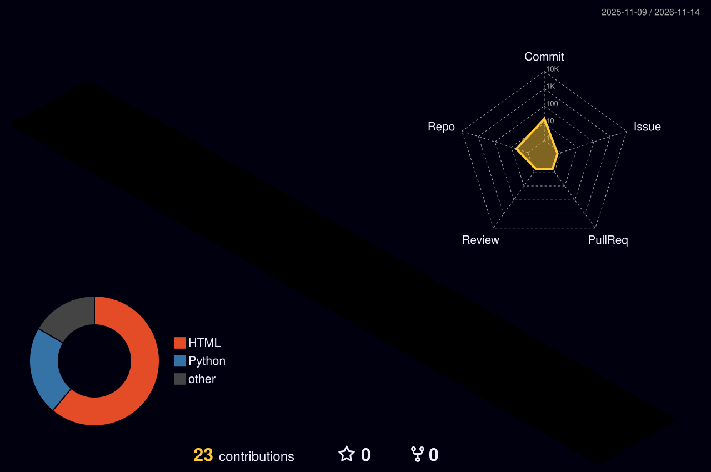

  

---

## 👨‍💻 About Me

- 🎯 **Targeting ML Engineer, AI Engineer,Software Development and Computer Vision roles** (internships and entry-level)
- 🔭 Currently building **multimodal emergency vehicle detection** — a YOLOv8 vision model and a siren-audio CNN joined by context-aware fusion
- 🌱 Exploring **deep learning, computer vision, audio ML and model robustness**
- 🛠️ Also building **voice assistants, UIs and full-stack projects**
- 📫 Reach me: **siramansinghofficial@gmail.com**

---

## 🧠 What I Work On

| Area | What I do |
|---|---|
| 👁️ **Computer Vision** | Object detection with YOLOv8, image preprocessing and context estimation with OpenCV |
| 🔊 **Audio ML** | Log-mel spectrograms, CNN siren classifier, SpecAugment |
| 🔗 **Multimodal AI** | Late fusion of vision and audio, dynamic modality weighting by lighting, weather and traffic |
| 📈 **Model evaluation** | Precision / recall / F1, confusion matrices, threshold and fusion tuning |

---

## 🧰 Tech Stack

---

## 🚀 Featured Projects

---

## 🐍 Contribution Snake

<picture>
  <source media="(prefers-color-scheme: dark)" srcset="https://raw.githubusercontent.com/siramansingh/siramansingh/output/github-snake-dark.svg" />
  <source media="(prefers-color-scheme: light)" srcset="https://raw.githubusercontent.com/siramansingh/siramansingh/output/github-snake.svg" />
  
</picture>

---

## 🌐 3D Contribution View

---

## 📊 GitHub Stats & Activity

 

 

---

## 🤝 Let's Connect — Open to ML / AI Opportunities

<!-- EDIT: add your LinkedIn / portfolio links, e.g.

-->

 

⭐ *If you like my projects, consider giving them a star!* ⭐

